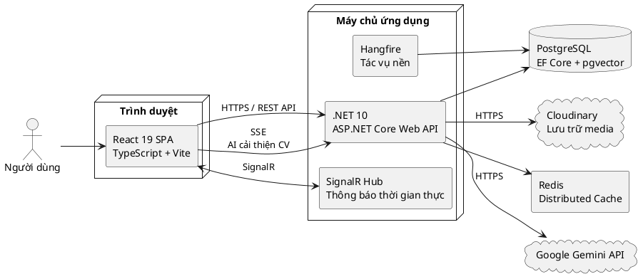
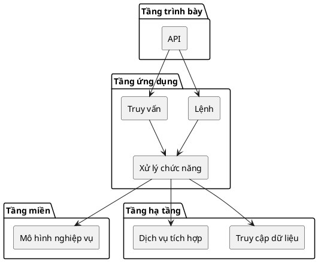
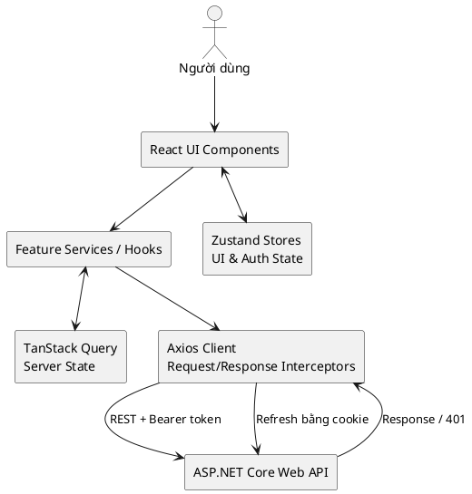
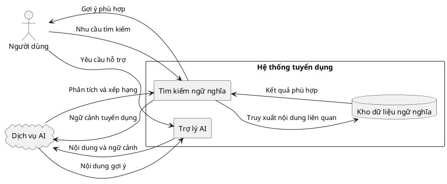

# 2.1. Kiến trúc hệ thống

## 2.1.1. Sơ đồ kiến trúc tổng thể

**Hình 2.1. Sơ đồ kiến trúc tổng thể hệ thống Client–Server**

Hệ thống được tổ chức theo mô hình client–server, trong đó người dùng thao tác với ứng dụng web thông qua trình duyệt. Ứng dụng gửi yêu cầu tới máy chủ để xử lý nghiệp vụ và nhận dữ liệu phản hồi. Kiến trúc phân tách giao diện người dùng, xử lý nghiệp vụ, lưu trữ dữ liệu và các dịch vụ hỗ trợ thành những thành phần có vai trò riêng.

Máy chủ ứng dụng kết nối với cơ sở dữ liệu để lưu trữ thông tin tuyển dụng và hồ sơ, đồng thời sử dụng bộ nhớ đệm để hỗ trợ truy cập dữ liệu. Các chức năng trí tuệ nhân tạo và lưu trữ tệp được kết nối thông qua những dịch vụ chuyên biệt. Tác vụ nền được xử lý riêng nhằm hỗ trợ các công việc không cần thực hiện trực tiếp trong phiên tương tác của người dùng. Client và máy chủ trao đổi dữ liệu qua các giao diện phù hợp với từng loại tương tác, bao gồm yêu cầu nghiệp vụ, phản hồi liên tục và thông báo thời gian thực.

## 2.1.2. Kiến trúc phía Server

**Hình 2.2. Kiến trúc các tầng phía máy chủ và phân tách lệnh, truy vấn**

Phía máy chủ được tổ chức theo hướng Clean Architecture, chia thành bốn tầng Domain, Application, Infrastructure và API. Cách tổ chức này tách biệt các quy tắc nghiệp vụ khỏi chi tiết giao tiếp, lưu trữ và tích hợp bên ngoài. Tầng Domain chứa mô hình nghiệp vụ của hệ thống, bao gồm các thực thể và quy tắc đảm bảo tính hợp lệ của dữ liệu trong suốt vòng đời nghiệp vụ.

Tầng Application tổ chức các chức năng nghiệp vụ thành những ca sử dụng. Trong tầng này, hệ thống áp dụng CQRS bằng cách phân tách các yêu cầu thành lệnh làm thay đổi dữ liệu và truy vấn lấy dữ liệu. Sự phân chia này giúp luồng đọc và luồng ghi có trách nhiệm rõ ràng, đồng thời hỗ trợ tổ chức xử lý theo từng ca sử dụng. Dữ liệu đầu vào được kiểm tra trước khi xử lý. Tầng API chuyển yêu cầu tới tầng ứng dụng, còn tầng Infrastructure cung cấp khả năng truy cập dữ liệu và kết nối các dịch vụ hỗ trợ.

Tầng Infrastructure đảm nhiệm việc lưu trữ và truy xuất dữ liệu, đồng thời kết nối hệ thống với bộ nhớ đệm, dịch vụ trí tuệ nhân tạo, dịch vụ lưu trữ tệp và thành phần xử lý tác vụ nền. Việc tách riêng tầng này giúp các chức năng nghiệp vụ tập trung vào quy trình xử lý, không phụ thuộc trực tiếp vào cách hệ thống kết nối với cơ sở dữ liệu và các dịch vụ bên ngoài.

Tầng API là cửa ngõ giao tiếp giữa client và máy chủ. Tầng này tiếp nhận yêu cầu, xác thực và kiểm soát quyền truy cập trước khi chuyển yêu cầu tới tầng ứng dụng. Kết quả và lỗi được phản hồi theo cấu trúc thống nhất nhằm duy trì tính nhất quán trong giao tiếp.

## 2.1.3. Kiến trúc phía Client

**Hình 2.3. Các thành phần và luồng dữ liệu phía Client**

Phía client được xây dựng theo mô hình ứng dụng web dựa trên các thành phần giao diện. Các thành phần này trình bày thông tin và tiếp nhận thao tác của người dùng, sau đó phối hợp với các dịch vụ phía client để trao đổi dữ liệu với máy chủ.

Dữ liệu nhận từ máy chủ được quản lý riêng với trạng thái giao diện. Cơ chế quản lý dữ liệu máy chủ hỗ trợ truy vấn, lưu giữ tạm thời và cập nhật dữ liệu khi cần. Trạng thái giao diện dùng chung được quản lý tập trung để các thành phần có thể phối hợp nhất quán. Lớp giao tiếp API đảm nhiệm việc gửi yêu cầu, nhận phản hồi và phối hợp xác thực trong quá trình trao đổi với máy chủ.

## 2.1.4. Phân hệ AI và tìm kiếm ngữ nghĩa

**Hình 2.4. Khái quát phân hệ AI và tìm kiếm ngữ nghĩa**

Phân hệ AI mở rộng khả năng hỗ trợ người dùng bằng cách kết hợp dữ liệu tuyển dụng với các mô hình trí tuệ nhân tạo. Ở mức khái quát, hệ thống tiếp nhận yêu cầu và dữ liệu liên quan, tìm hoặc chuẩn bị ngữ cảnh phù hợp, sau đó chuyển thông tin cần thiết tới dịch vụ AI để tạo kết quả hỗ trợ.

Tìm kiếm ngữ nghĩa biểu diễn nội dung như hồ sơ ứng viên và yêu cầu công việc dưới dạng vector. Nhờ đó, hệ thống có thể so sánh ý nghĩa tổng quát giữa các nội dung thay vì chỉ đối chiếu từ khóa trùng khớp. Các kết quả gần với nhu cầu được dùng làm cơ sở tạo gợi ý hoặc phân tích mức độ phù hợp.

Trong những tương tác cần phản hồi liên tục, kết quả có thể được truyền dần về giao diện để người dùng theo dõi quá trình tạo nội dung. Cách tổ chức này giúp kết hợp khả năng truy xuất thông tin với khả năng sinh ngôn ngữ, đồng thời giữ vai trò của dữ liệu tuyển dụng làm ngữ cảnh cho kết quả AI.

