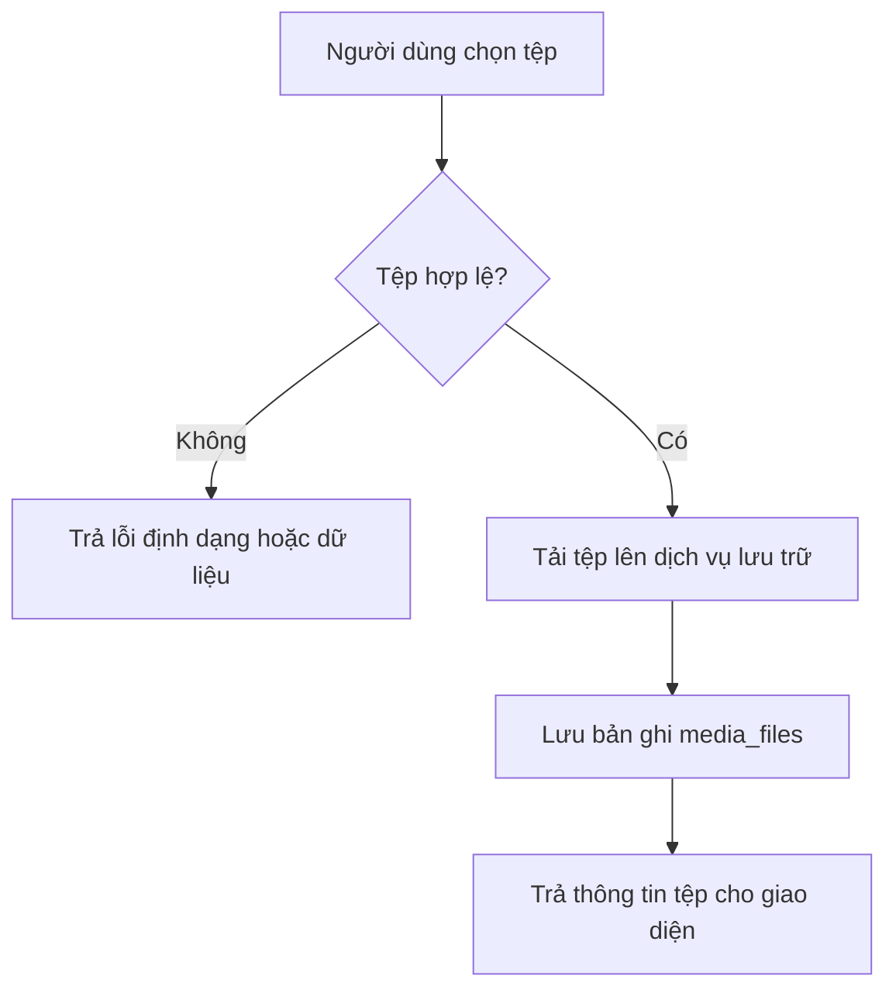

# 2.3. Thiết kế chi tiết các chức năng

Phần này trình bày các chức năng được xây dựng trong SmartHire theo luồng thao tác của từng vai trò. Nội dung được tổng hợp từ giao diện và mã nguồn hiện có; các kết quả AI, trạng thái nghiệp vụ và quyền thao tác được mô tả theo cách hệ thống đang xử lý.

## 2.3.1. Chức năng Đăng ký tài khoản

**Mục đích:** Cho phép người dùng mới tạo tài khoản Candidate hoặc Recruiter để sử dụng các chức năng tương ứng của nền tảng.

**Giao diện:** Biểu mẫu đăng ký gồm họ tên, email, số điện thoại và mật khẩu; người dùng lựa chọn luồng đăng ký phù hợp với vai trò. Hệ thống cũng hỗ trợ đăng nhập/đăng ký bằng Google thông qua Firebase.

**Dữ liệu được dùng:** `users`, `roles`, `user_roles`, `refresh_tokens`.

**Cách xử lý:** Khi nhận biểu mẫu, hệ thống kiểm tra các trường bắt buộc và tính hợp lệ của dữ liệu, sau đó kiểm tra email đã được sử dụng hay chưa. Nếu dữ liệu hợp lệ, hệ thống tạo tài khoản và gán vai trò Candidate hoặc Recruiter theo luồng đăng ký được chọn. Với đăng nhập Google, máy chủ xác minh Firebase ID token; nếu tài khoản chưa tồn tại và yêu cầu hợp lệ, hệ thống tạo người dùng mới và gán vai trò tương ứng. Sau khi xác thực thành công, hệ thống tạo Access Token và Refresh Token, lưu thông tin Refresh Token đã băm trong cơ sở dữ liệu và trả thông tin phiên đăng nhập cho giao diện. Nếu email đã gắn với một tài khoản Google khác hoặc dữ liệu không hợp lệ, hệ thống trả lỗi và không tạo phiên mới.

## 2.3.2. Chức năng Đăng nhập, làm mới phiên và đăng xuất

**Mục đích:** Xác thực người dùng, duy trì phiên truy cập và cho phép thu hồi phiên đăng nhập.

**Giao diện:** Màn hình đăng nhập nhận email và mật khẩu; có lựa chọn đăng nhập bằng Google. Các thao tác duy trì phiên và đăng xuất được thực hiện thông qua lớp giao tiếp API của ứng dụng.

**Dữ liệu được dùng:** `users`, `user_roles`, `refresh_tokens`.

**Cách xử lý:** Với đăng nhập bằng email và mật khẩu, hệ thống tìm tài khoản theo email, kiểm tra mật khẩu bằng bộ xác thực mật khẩu và kiểm tra trạng thái tài khoản. Nếu thông tin hợp lệ, hệ thống sinh Access Token và Refresh Token mới; Refresh Token được lưu dưới dạng băm. Khi Access Token cần được làm mới, hệ thống xác thực Refresh Token hiện tại, thu hồi token cũ và cấp token mới trong giao dịch. Khi đăng xuất, người dùng có thể thu hồi Refresh Token đang dùng hoặc yêu cầu thu hồi toàn bộ phiên chưa hết hiệu lực. Nếu token không hợp lệ, hết hạn hoặc đã bị thu hồi, yêu cầu bị từ chối.

## 2.3.3. Chức năng Quản lý thông tin tài khoản và đổi mật khẩu

**Mục đích:** Cho phép Candidate, Recruiter và Admin xem thông tin tài khoản hiện tại, cập nhật hồ sơ cá nhân và đổi mật khẩu.

**Giao diện:** Khu vực hồ sơ cá nhân hiển thị họ tên, email, số điện thoại và ảnh đại diện. Biểu mẫu cập nhật gửi riêng các trường được phép thay đổi; chức năng đổi mật khẩu nhận mật khẩu hiện tại, mật khẩu mới và lựa chọn thu hồi các phiên khác.

**Dữ liệu được dùng:** `users`, `media_files`, `refresh_tokens`.

**Cách xử lý:** Hệ thống xác định người dùng từ danh tính đã xác thực, truy vấn tài khoản hiện tại và trả thông tin hồ sơ. Khi cập nhật, chỉ các trường được hỗ trợ như họ tên, số điện thoại và tệp ảnh đại diện mới được chấp nhận; các trường ngoài danh sách cho phép bị từ chối. Nếu ảnh đại diện cũ không còn được tham chiếu, hệ thống đưa tác vụ xóa tệp vào hàng đợi nền. Khi đổi mật khẩu, hệ thống kiểm tra mật khẩu hiện tại trước khi băm và lưu mật khẩu mới; nếu người dùng yêu cầu, các Refresh Token còn hiệu lực khác sẽ bị thu hồi.

## 2.3.4. Chức năng Tải lên và quản lý tệp đa phương tiện

**Mục đích:** Cung cấp tệp ảnh và PDF để sử dụng trong hồ sơ, CV và thông tin doanh nghiệp.

**Giao diện:** Các biểu mẫu hồ sơ, CV và doanh nghiệp cho phép chọn tệp ảnh; một số luồng có thể tải lên tệp PDF. Tệp đã tải lên được liên kết vào đối tượng nghiệp vụ tương ứng.

**Dữ liệu được dùng:** `media_files` và các bản ghi nghiệp vụ có tham chiếu đến tệp.

**Cách xử lý:** Máy chủ kiểm tra định dạng, tên và kích thước tệp theo quy tắc của loại tải lên. Tệp hợp lệ được gửi đến dịch vụ lưu trữ; sau khi nhận đường dẫn và định danh lưu trữ, hệ thống tạo bản ghi media gắn với chủ sở hữu. Khi xóa, hệ thống kiểm tra quyền sở hữu (Admin có thể thao tác theo quyền quản trị) và kiểm tra tệp có đang được đối tượng khác tham chiếu hay không. Nếu không còn tham chiếu, bản ghi được đánh dấu xóa trước, sau đó tác vụ nền thực hiện xóa tệp vật lý khỏi dịch vụ lưu trữ. Nếu tệp đang được sử dụng, thao tác xóa bị từ chối.

