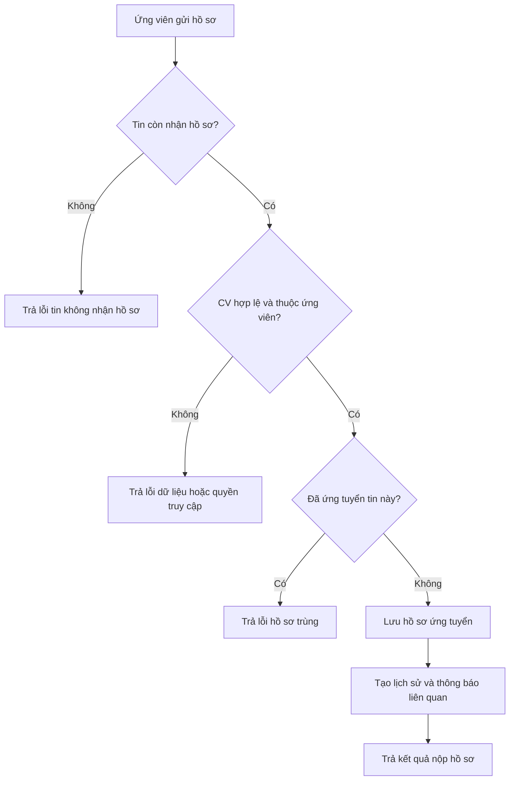

## 2.3.8. Chức năng Tìm kiếm và xem chi tiết việc làm

**Mục đích:** Giúp khách truy cập và ứng viên tìm tin tuyển dụng công khai theo nhu cầu, xem chi tiết công việc và thông tin công ty đăng tuyển.

**Giao diện:** Trang tìm việc cung cấp từ khóa, bộ lọc theo doanh nghiệp, khoảng lương, tỉnh/thành phố, phường/xã, cấp bậc, loại công việc, hình thức làm việc, kinh nghiệm và ngành nghề; danh sách hỗ trợ sắp xếp theo ngày đăng hoặc mức lương cao nhất. Trang chi tiết trình bày mô tả, yêu cầu, địa điểm, hình thức làm việc, mức lương, kỹ năng, ngành nghề và doanh nghiệp.

**Dữ liệu được dùng:** `job_postings`, `companies`, `job_skills`, `skills`, `job_industries`, `industries`, `provinces`, `wards`.

**Cách xử lý:** Hệ thống kiểm tra và chuẩn hóa tiêu chí tìm kiếm, xác thực danh mục địa điểm/ngành nghề được chọn rồi truy vấn tin công khai theo từ khóa và điều kiện lọc. Máy chủ không cho kết hợp khoảng kinh nghiệm với số năm kinh nghiệm cụ thể, cũng như không cho chọn “thương lượng” cùng khoảng lương. Kết quả được sắp xếp theo ngày đăng hoặc mức lương tối đa, phân trang và trả kèm thông tin tóm tắt về công ty, địa điểm, kỹ năng và ngành nghề. Khi xem chi tiết, máy chủ tìm tin theo mã và trả các thông tin liên quan. Nếu mã tin không tồn tại, tin không ở trạng thái công khai hoặc tiêu chí lọc không hợp lệ, hệ thống trả lỗi/kết quả tương ứng thay vì hiển thị thông tin nội bộ.

## 2.3.9. Chức năng Lưu và bỏ lưu tin tuyển dụng

**Mục đích:** Cho phép ứng viên đánh dấu tin tuyển dụng để xem lại và quản lý danh sách tin đã lưu.

**Giao diện:** Thao tác lưu/bỏ lưu được cung cấp tại thẻ hoặc trang chi tiết tin. Trang tin đã lưu hiển thị danh sách và cho phép mở lại tin tuyển dụng.

**Dữ liệu được dùng:** `job_bookmarks`, `job_postings`, `companies`.

**Cách xử lý:** Khi ứng viên lưu tin, hệ thống xác định người dùng từ phiên đăng nhập, kiểm tra tin tồn tại và ở trạng thái được phép lưu, sau đó tạo liên kết giữa ứng viên và tin. Nếu liên kết đã tồn tại hoặc tin chưa được phát hành, hệ thống trả lỗi nghiệp vụ phù hợp. Khi bỏ lưu, hệ thống kiểm tra liên kết của chính ứng viên rồi xóa liên kết đó. Danh sách tin đã lưu được truy vấn theo người dùng hiện tại và phân trang.

## 2.3.10. Chức năng Đăng và quản lý tin tuyển dụng

**Mục đích:** Cho phép thành viên có quyền phù hợp của doanh nghiệp tạo, chỉnh sửa và quản lý trạng thái các vị trí tuyển dụng.

**Giao diện:** Biểu mẫu tin tuyển dụng nhận tiêu đề, mô tả, yêu cầu, địa điểm, hình thức công việc, cấp bậc, kinh nghiệm, mức lương, ngành nghề, kỹ năng và thời hạn. Khu vực quản lý công ty hiển thị danh sách tin và trạng thái hiện tại.

**Dữ liệu được dùng:** `job_postings`, `companies`, `company_memberships`, `job_skills`, `skills`, `job_industries`, `industries`, `provinces`, `wards`.

**Cách xử lý:** Khi tạo tin, hệ thống kiểm tra dữ liệu bắt buộc, giá trị mức lương, số lượng tuyển, mô tả và các mã danh mục liên quan. Doanh nghiệp phải được xác minh và người tạo phải là thành viên đang hoạt động; địa điểm, ngành nghề và kỹ năng cũng phải thuộc các danh mục đang hoạt động. Tin mới được lưu ở trạng thái chờ kiểm duyệt. Khi tin được Admin phát hành, hệ thống tạo thông báo cho người theo dõi doanh nghiệp. Khi cập nhật hoặc đóng tin, máy chủ tiếp tục kiểm tra người thao tác có vai trò Recruiter và membership đang hoạt động tại công ty sở hữu tin; tin đã đóng hoặc hết hạn không thể đóng lại. Tác vụ nền chuyển tin đã phát hành quá hạn sang trạng thái hết hạn.

## 2.3.11. Chức năng Ứng tuyển và theo dõi hồ sơ

**Mục đích:** Cho phép ứng viên nộp hồ sơ vào tin tuyển dụng và theo dõi trạng thái xử lý; nhà tuyển dụng xem danh sách hồ sơ nhận được.

**Giao diện:** Biểu mẫu ứng tuyển cho phép chọn phiên bản CV trực tuyến hoặc tệp CV đã tải lên, kèm thư giới thiệu. Khu vực ứng viên hiển thị các hồ sơ đã nộp, trạng thái và lịch sử thay đổi; khu vực nhà tuyển dụng hiển thị hồ sơ theo từng tin.

**Dữ liệu được dùng:** `applications`, `job_postings`, `cv_versions`, `media_files`, `application_status_histories`, `company_memberships`, `ai_match_results`, `notifications`.

**Cách xử lý:** Khi nhận yêu cầu ứng tuyển, hệ thống xác định ứng viên hiện tại, kiểm tra tin đang phát hành, doanh nghiệp đã xác minh và hạn nộp chưa qua; đồng thời xác nhận ứng viên chưa nộp hồ sơ trùng cho cùng tin. Ứng viên có thể chọn phiên bản CV thuộc sở hữu của mình hoặc tệp PDF đã tải lên; tệp tải lên phải thuộc ứng viên, không vượt quá 5 MB và chưa được dùng cho hồ sơ khác. Hệ thống tạo hồ sơ cùng lịch sử trạng thái ban đầu trong một giao dịch. Nếu dùng CV trực tuyến và có dữ liệu phù hợp, hệ thống tính điểm tương thích bằng bộ máy so khớp và lưu kết quả gắn với hồ sơ. Sau khi nộp, hệ thống lưu thông báo cho các thành viên đang hoạt động của công ty; khi phát thông báo thời gian thực, cơ chế giới hạn trong cửa sổ 10 giây giúp giảm số lượng thông báo dồn dập. Lỗi ở phần thông báo không làm hủy hồ sơ đã nộp thành công. Nhà tuyển dụng có vai trò Recruiter và membership công ty đang hoạt động mới được đổi trạng thái hồ sơ; hệ thống chỉ chấp nhận các trạng thái đích được hỗ trợ và kiểm tra quy tắc chuyển trạng thái miền, ghi người thay đổi, trạng thái trước/sau và thời điểm vào lịch sử, sau đó tạo thông báo cho ứng viên. Ứng viên chỉ xem được hồ sơ của mình; yêu cầu sai quyền, tin không nhận hồ sơ, CV không hợp lệ hoặc hồ sơ trùng bị từ chối.

